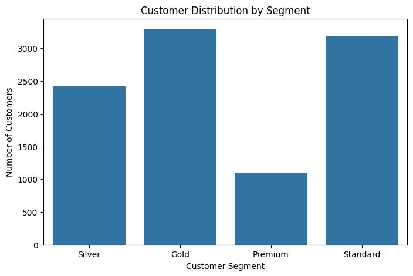
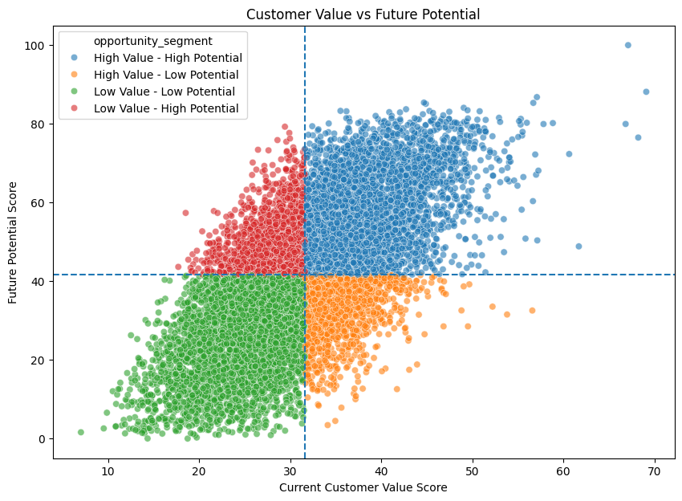
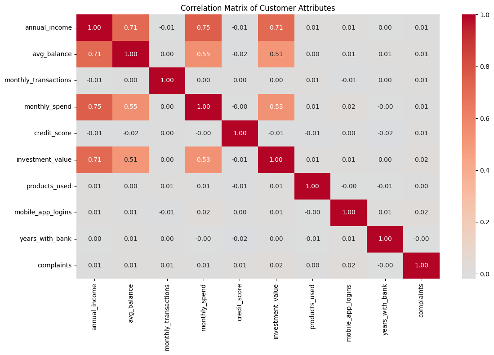
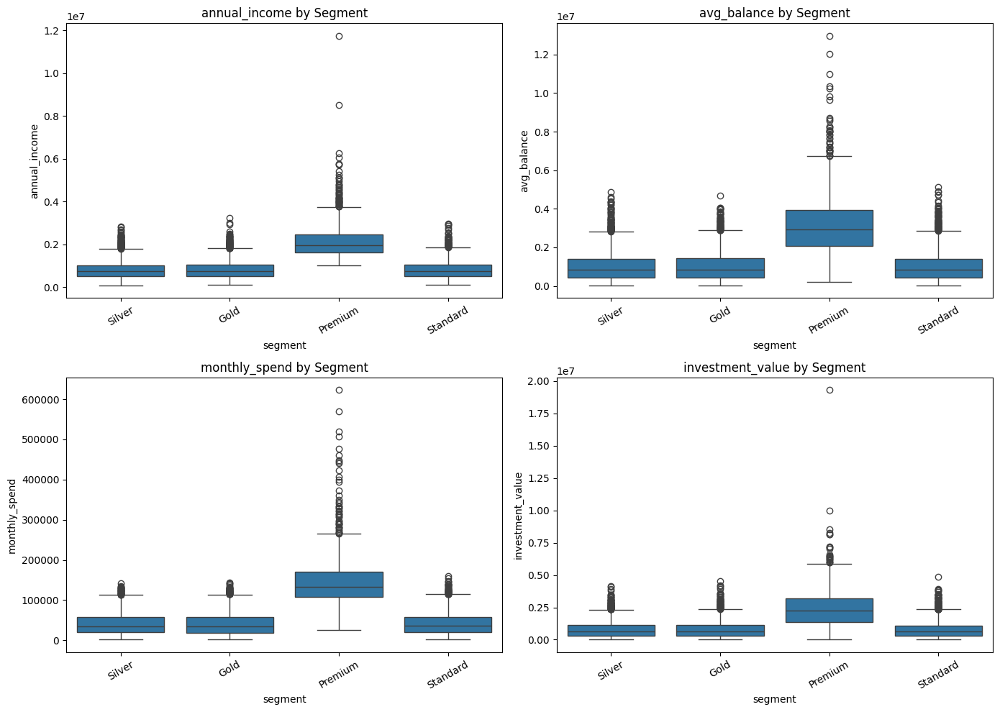

# Fintech Customer Segmentation & High-Value Customer Identification

Banks often call a customer "premium" just because they hold a large balance. That rule misses customers who invest heavily, spend a lot on cards, use many products and are very active digitally. This project builds a **data-driven customer-value engine** that:

1. Scores every customer on **7 dimensions** of value
2. Groups customers into **Standard / Silver / Gold / Premium** with **K-Means clustering**
3. Finds customers with **low current value but high future potential**
4. Ranks them by priority and **recommends an action** for each (upgrade, cross-sell, digital engagement)

**Tech stack:** Python · Pandas · NumPy · Scikit-learn · Matplotlib · Seaborn · Excel

---

## Dataset

`data/High_Value_Customer_Identification_Final.xlsx` holds data for **10,000 bank customers** (no missing values, no duplicates).

| Sheet | Contents |
|---|---|
| `Customer_360` | One row per customer: age, gender, income, balance, transactions, spend, credit score, loan, investments, products used, app logins, tenure, complaints + component scores |
| `Segment_Profile` | Average profile of each segment |
| `Value_Contribution` | Customer share vs spend share per segment |
| `Scoring_Framework` | Weights used for the Customer Value Score |
| `Recommendations` | Product recommendation mix per segment |

## Approach

```
Customer data → Data quality checks → EDA → Feature engineering
→ Customer Value Score → Value-vs-Potential matrix
→ K-Means segmentation → Opportunity prioritisation → Recommended action
```

**Customer Value Score.** The 7 component scores are Min-Max scaled to 0–100 and then combined with business weights:

| Dimension | Weight |
|---|---|
| Financial strength | 25% |
| Transaction behaviour | 15% |
| Spending behaviour | 15% |
| Credit profile | 15% |
| Customer engagement | 10% |
| Relationship value | 10% |
| Future potential | 10% |

**Clustering.** 12 raw features are standardised (StandardScaler) and passed to K-Means with k = 4, one cluster for each business tier.

## Key results

- **The Premium tier is 11% of customers but drives 30.5% of total monthly spend.**
- Annual income correlates strongly with monthly spend (r = 0.75), average balance (0.71) and investments (0.71).
- K-Means recovers the Premium segment with **94.5% agreement**. Overall agreement with the bank's existing segments is 60.4%, which means the behaviour-based clusters regroup many Gold and Silver customers differently.
- **292 customers** are in the top 10% by income but are not Premium, which makes them direct upgrade candidates.
- The value-vs-potential matrix flags **1,338 "Low Value – High Potential" customers**. They are ranked into 335 High, 334 Medium and 669 Low priority.
- Each prioritised customer gets an action, for example *Relationship Deepening / Upgrade* (219), *Premium Upgrade / Wealth Products* (90), *Targeted Cross-sell* (334) and *Digital Engagement* (669).

## Visuals

| | |
|---|---|
|  |  |
|  |  |

## Project structure

```
├── Fintech_Customer_Segmentation.ipynb   # full analysis
├── data/High_Value_Customer_Identification_Final.xlsx
├── reports/Project_Concept_Report.pdf     # problem statement & system design
├── reports/EDA_Report.docx                # detailed EDA write-up
├── images/                                # charts exported from the notebook
└── requirements.txt
```

## How to run

```bash
pip install -r requirements.txt
jupyter notebook Fintech_Customer_Segmentation.ipynb
```

## Future work

- Choose k with the elbow method and silhouette score
- Train a classifier (Logistic Regression / Random Forest / XGBoost) to predict premium eligibility
- Add time-based transaction data for true trend analysis
- Build an interactive dashboard (Power BI / Streamlit)

---
**Author:** Vaishnavi Bharambe
